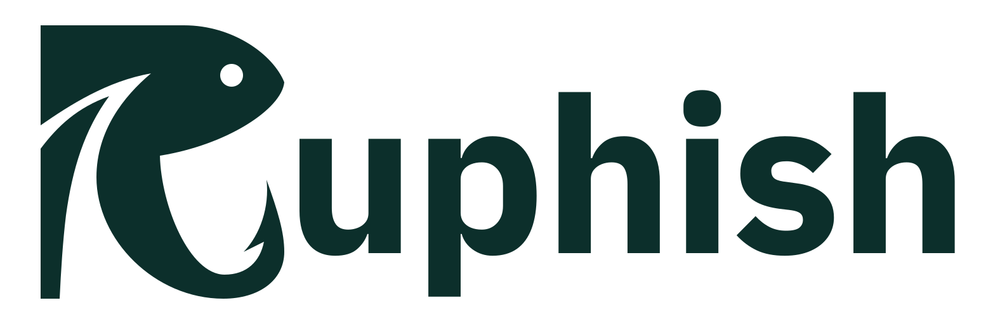
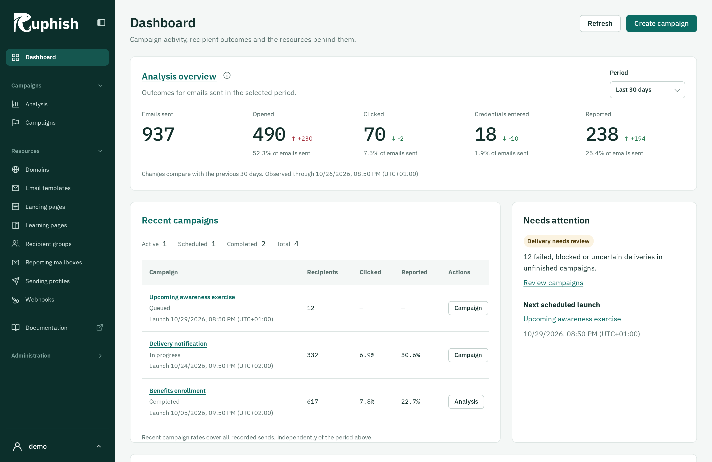

<picture>
  <source media="(prefers-color-scheme: dark)" srcset="assets/ruphish-wordmark-white.svg">
  
</picture>

Ruphish is a phishing-simulation application with a native Rust server and a Rust/WASM admin interface. Prepare personalized campaigns, deliver them through your SMTP service, and review delivery, participant interactions, and reported messages in one place.

**[Try the demo](https://demo.ruphish.com/)** with username `demo` and password `demodemo`.

Ruphish aims to be a compatible, drop-in replacement for Gophish while adding a new interface, persistent campaign drafts, verified domains, richer analysis, and explicit delivery recovery. Full compatibility cannot be guaranteed for every integration or deployment; review the [documented differences](https://ruphish.com/docs/migration/differences-from-gophish/) before migrating.

## What you can do

- Manage recipient groups, email templates, landing pages, attachments, and sending profiles.
- Save campaign drafts, review the audience and content, and launch immediately or schedule delivery.
- Inspect delivery attempts and resolve uncertain outcomes without assuming a failed connection means a message was never sent.
- Explore campaign and recipient timelines, distinguish observed events from summary metrics, and export CSV or XLSX reports.
- Process reported messages through multiple IMAP mailboxes and deliver signed events to webhooks.
- Use English or German interface text with independent date-format and time-zone preferences.
- Automate workflows through compatible resource endpoints and Ruphish's added APIs.

Participant tracking is designed around interaction events and optional presence booleans. Entered usernames, passwords, OTPs, and arbitrary form values are outside the supported collection model. Read [participant data](https://ruphish.com/docs/user-guide/participant-data/) for behavior and verification limits.

## Start here

| Your goal | Guide |
| --- | --- |
| Try a contained exercise with a local inbox | [Your first campaign](https://ruphish.com/docs/getting-started/first-campaign/) |
| Install a release binary or run the Docker image | [Installation](https://ruphish.com/docs/getting-started/installation/) |
| Run campaigns and understand results | [User guide](https://ruphish.com/docs/user-guide/) |
| Configure databases, TLS, accounts, or recovery | [Administration](https://ruphish.com/docs/administration/) |
| Integrate with Ruphish | [HTTP API](https://ruphish.com/docs/api/) |
| Bring an existing Gophish installation across | [Migration and compatibility](https://ruphish.com/docs/migration/) |
| Change code, translations, or documentation | [Contributing](CONTRIBUTING.md) |
| Report a suspected security vulnerability | [Security policy](SECURITY.md) |

The HTTP interface separates `/api/` for public automation, `/auth/` for browser authentication/session data, and `/internal/` for browser-specific operations. See the [API overview](https://ruphish.com/docs/api/) before choosing an endpoint for an integration.

## Installation

The intended installation options are a release binary and a Docker image. SQLite is the default database; MySQL and PostgreSQL are also configurable. See [installation](https://ruphish.com/docs/getting-started/installation/) for setup and [database administration](https://ruphish.com/docs/administration/databases/) for provider requirements.

> TODO before publication: Publish the release binaries and Docker image, then complete and verify their installation instructions. These distribution options are not available yet.

For development, follow [contributing](CONTRIBUTING.md) for setup, architecture, and validation.

Read the [changelog](CHANGELOG.md) for user-visible changes and the [Code of Conduct](CODE_OF_CONDUCT.md) for community expectations and private conduct reporting.

## License and attribution

Ruphish is licensed under [MIT](LICENSE), copyright (c) 2026 Simon Peter Rothgang. Reused Gophish material and dependency notices are preserved in [THIRD-PARTY-NOTICES.md](THIRD-PARTY-NOTICES.md). Fixture credentials and recipient data are synthetic and must not be reused for an actual installation.
