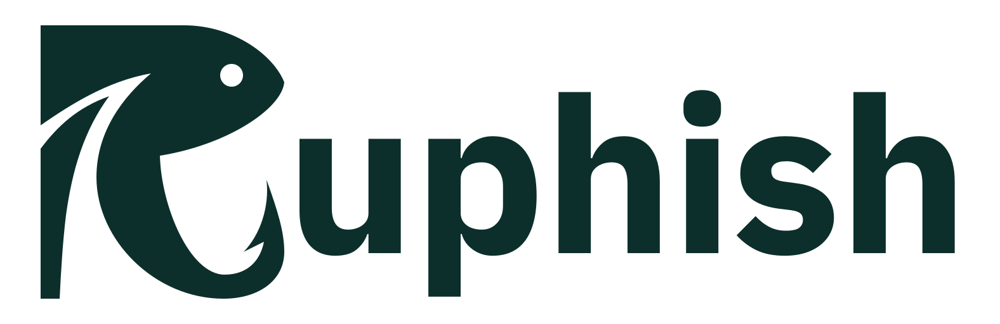
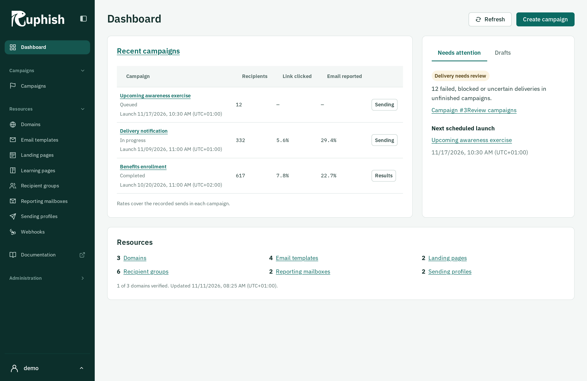

<picture>
  <source media="(prefers-color-scheme: dark)" srcset="assets/ruphish-wordmark-white.svg">
  
</picture>

[](https://github.com/srothgan/ruphish/releases/latest)
[](https://github.com/srothgan/ruphish/actions/workflows/pr.yml?query=branch%3Amain+event%3Apush)
[](https://ruphish.com/docs/)
[](https://github.com/srothgan/ruphish/blob/main/LICENSE)

Ruphish helps teams run phishing simulations, send personalized campaigns through their mail service, and understand the results.

**[Try the demo](https://demo.ruphish.com/)** with username `demo` and password `demodemo`.



## About

Ruphish is a successor to Gophish with a new interface and API. You can migrate supported Gophish SQLite and MySQL databases; review the [migration guide](https://ruphish.com/docs/migration/) before moving your data or adapting an integration.

## What you can do

- Manage recipient groups, email templates, landing pages, attachments, and sending profiles.
- Save campaign drafts, review the audience and content, and launch immediately or schedule delivery.
- Inspect delivery attempts and resolve uncertain outcomes without assuming a failed connection means a message was never sent.
- Explore campaign and recipient timelines, distinguish observed events from summary metrics, and export CSV or XLSX reports.
- Process reported messages through multiple IMAP mailboxes and deliver signed events to webhooks.
- Use English or German interface text with independent date-format and time-zone preferences.
- Automate workflows through Ruphish's HTTP API.

Participant tracking is designed around interaction events and optional presence booleans. Entered usernames, passwords, OTPs, and arbitrary form values are outside the supported collection model. Read [participant data](https://ruphish.com/docs/user-guide/results/participant-data/) for behavior and verification limits.

## Start here

| Your goal | Guide |
| --- | --- |
| Try and run a local campaign | [Your first campaign](https://ruphish.com/docs/getting-started/run-your-first-campaign/) |
| Install a release binary or run the Docker image | [Installation](https://ruphish.com/docs/getting-started/install-ruphish/) |
| Run campaigns and understand results | [User guide](https://ruphish.com/docs/user-guide/) |
| Configure databases, TLS, accounts, or recovery | [Administration](https://ruphish.com/docs/administration/) |
| Integrate with Ruphish | [HTTP API](https://ruphish.com/docs/api/) |
| Bring an existing Gophish installation across | [Migration and compatibility](https://ruphish.com/docs/migration/) |
| Change code, translations, or documentation | [Contributing](CONTRIBUTING.md) |
| Report a suspected security vulnerability | [Security policy](SECURITY.md) |

For your own application or automation, use an API key and follow the [HTTP API reference](https://ruphish.com/docs/api/) for endpoints, request and response examples, and permissions.

## Installation

Choose a native binary or Docker. Both include the server and browser interface and use SQLite by default.

### Native binary

The installer selects the latest full release and installs it for your user account.

Linux or macOS:

```sh
curl -fsSL https://www.ruphish.com/install.sh | sh
```

Windows PowerShell:

```powershell
irm https://www.ruphish.com/install.ps1 | iex
```

### Docker

With Docker running in Linux-container mode, save this as `compose.yaml` in a new installation folder:

```yaml
services:
  ruphish:
    image: ghcr.io/srothgan/ruphish:latest
    restart: unless-stopped
    stop_grace_period: 30s
    ports:
      - "127.0.0.1:3333:3333"
      - "127.0.0.1:8081:8081"
    volumes:
      - ruphish-data:/var/lib/ruphish
volumes:
  ruphish-data:
```

Run these commands from that folder:

```sh
docker compose pull
docker compose up -d --wait
docker compose logs ruphish
```

Open **http://127.0.0.1:3333**. This setup is accessible only from your computer and keeps its data in a persistent volume.

### Installation guides

- [Install Ruphish](https://ruphish.com/docs/getting-started/install-ruphish/) covers supported platforms, first startup, sign-in, and stopping or restarting.
- [Native installer reference](https://ruphish.com/docs/administration/hosting-and-maintenance/native-installer-reference/) covers development previews, exact versions, directories, PATH settings, updates, and removal.
- [Hosting and maintenance](https://ruphish.com/docs/administration/hosting-and-maintenance/) covers services, network access, HTTPS, databases, backups, and upgrades.

For development, follow [contributing](CONTRIBUTING.md) for setup, architecture, and validation.

Read the [changelog](CHANGELOG.md) for user-visible changes and the [Code of Conduct](CODE_OF_CONDUCT.md) for community expectations and private conduct reporting.

## License and attribution

Ruphish is licensed under [MIT](LICENSE), copyright (c) 2026 Simon Peter Rothgang. Reused Gophish material and dependency notices are preserved in [THIRD-PARTY-NOTICES.md](THIRD-PARTY-NOTICES.md). Fixture credentials and recipient data are synthetic and must not be reused for an actual installation.
